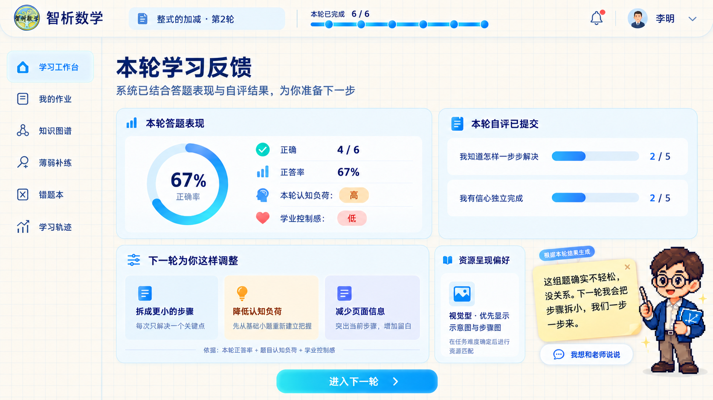

# 自适应学习反馈页 UI 设计说明

**页面名称：** 本轮学习反馈（Adaptive Learning Feedback）  
**适用角色：** 学生端  
**适用范围：** 整式、分式、一元一次方程等已启用双层适配机制的知识点  
**设计状态：** 视觉与交互实现基线  
**对应概念图：** [adaptive-feedback-ivory-grid-concept.png](ui-mockups/adaptive-feedback-ivory-grid-concept.png)



## 1. 页面定位

本页是学生完成一轮练习、提交学业控制感自评后的**结果反馈与下一轮过渡页**。它不是常驻首页，也不是用于展示全部系统功能的宣传页。

页面要完成四件事：

1. 让学生看见本轮的客观答题结果。
2. 让学生确认自己的主观感受已经被记录。
3. 用可理解的语言说明系统会怎样调整下一轮任务。
4. 在需要时给予适度情绪支持，并保留向教师求助的入口。

核心表达为：**系统既看答题表现，也看学生完成任务时的控制感；先确定任务难度，再匹配资源呈现形式。**

> 本页的结果用于学习支持，不构成心理健康诊断，也不得向学生显示“风险”“异常”等标签。

## 2. 生效时机与进入条件

```text
完成一轮练习
  → 系统计算正确率与本轮题目认知负荷
  → 学生完成并提交控制感自评
  → 后端生成适配决策
  → 进入本轮学习反馈页
  → 学生确认后进入下一轮任务
```

只有在以下条件均满足时展示本页完整内容：

- 当前知识点在自适应机制白名单内；
- 本轮题目均已完成有效判定，或已完成教师复核；
- 自评必答项已提交成功；
- 后端已返回适配决策。

自评未提交时，应先在原练习结果页展示自评卡；不得提前展示“下一轮为你这样调整”的结论。

## 3. 视觉基线

### 3.1 整体原则

- **登录页不改动。** 登录页可以保留现有蓝青教育科技封面；本页属于系统内部工作界面。
- 内部界面使用暖米白方格背景，形成稳定、安静的学习纸张氛围。
- 蓝色只用于导航、主要操作、数据强调和边框；黄色仅用于临时心理支持便签。
- 便签与像素老师是**结果触发的情绪支持组件**，不应在普通首页、日常题目页或未完成自评时常驻。
- 所有信息用真实 DOM、CSS、图表和可访问控件实现；概念图不可直接作为整页背景图。

### 3.2 背景与设计令牌

| 用途 | 建议值 | 说明 |
| --- | --- | --- |
| 页面底色 | `#FCFAF4` | 暖米白，不使用纯白或深色插画背景。 |
| 方格线 | `rgba(73, 124, 180, 0.10)` | 1px 细线，间距 28px，不能干扰正文。 |
| 主文字 | `#102A56` | 深海军蓝，保证阅读对比度。 |
| 次级文字 | `#58708F` | 用于说明、依据和辅助标签。 |
| 主操作蓝 | `#1697F6` → `#2385F4` | “进入下一轮”等主要按钮可使用轻渐变。 |
| 卡片底色 | `rgba(255, 255, 255, 0.88)` | 结合浅蓝描边形成分区。 |
| 卡片边框 | `#C8E9FF` | 1px，不使用厚重发光。 |
| 低控制感提示 | `#FFF0B3` / `#8B6511` | 仅用于临时便签，不表示失败。 |
| 稳定状态 | `#E7F5DD` / `#2F6B42` | 中等控制感、持续推进。 |
| 挑战状态 | `#DDECFF` / `#234B82` | 高控制感下的挑战与校准。 |

推荐复用项目的 `frontend/src/styles/notebook.css` 设计令牌，并在本页补充：

```css
.adaptive-feedback-page {
  background-color: #FCFAF4;
  background-image:
    linear-gradient(rgba(73, 124, 180, .10) 1px, transparent 1px),
    linear-gradient(90deg, rgba(73, 124, 180, .10) 1px, transparent 1px);
  background-size: 28px 28px;
}
```

### 3.3 字体、圆角和阴影

- 正文：`PingFang SC`、`HarmonyOS Sans SC`、`Microsoft YaHei` 或项目现有 `--nb-font-body`。
- 页面标题：使用清晰的黑体字重 `700–800`，不使用大面积手写体。
- 数值：可使用项目现有 `--nb-font-num`，突出 `67%`、`4 / 6` 等数据。
- 普通卡片圆角：16px；标签、输入条和按钮圆角：10–14px。
- 阴影：仅使用轻柔阴影，例如 `0 8px 22px rgba(40, 91, 140, .10)`。
- 手写感只保留在便利贴边缘和极少量辅助批注中，不能影响核心数据阅读。

## 4. 页面结构

桌面端采用“顶部导航 + 左侧导航 + 主内容双列”的结构。

```text
┌──────────────────── 顶部导航：Logo / 当前轮次 / 进度 / 消息 / 学生信息 ────────────────────┐
├──────── 左侧导航 ────────┬──────────────────────── 主内容区 ───────────────────────────┤
│ 学习工作台               │ 本轮学习反馈 / 一句说明                                      │
│ 我的作业                 │ ┌────────── 本轮答题表现 ──────────┐ ┌────── 本轮自评已提交 ──────┐ │
│ 知识图谱                 │ │ 正答率环形图 + 数据摘要            │ │ 两项控制感自评 + 得分        │ │
│ 薄弱补练                 │ └─────────────────────────────────┘ └───────────────────────────┘ │
│ 错题本                   │ ┌──────────── 下一轮为你这样调整 ────────────┐ ┌── 资源呈现偏好 ──┐        │
│ 学习轨迹                 │ │ 分步 / 降负荷 / 低信息密度                 │ │ VARK 次级卡片    │        │
│                          │ └───────────────────────────────────────────┘ └──────────────────┘        │
│                          │                 [ 进入下一轮 ]                    [触发式便签 + 像素老师] │
└──────────────────────────┴──────────────────────────────────────────────────────────────┘
```

### 4.1 顶部导航

**高度：** 76–88px；固定在内容区顶部。  
**内容：**

- 原有项目 Logo，禁止重新绘制或替换；
- 当前知识点与轮次，如“整式的加减 · 第 2 轮”；
- 本轮完成进度，如“本轮已完成 6 / 6”；
- 消息图标、学生头像、姓名与下拉入口。

顶部不放大脑、公式、粒子、光带等登录封面背景元素。

### 4.2 左侧导航

**宽度：** 桌面端 220–240px。  
**菜单：** 学习工作台、我的作业、知识图谱、薄弱补练、错题本、学习轨迹。  
**激活样式：** 浅蓝底、学习蓝图标、半透明描边；不使用大面积高饱和色。

在 1024px 以下折叠为图标侧栏；在 768px 以下改为顶部抽屉菜单。

## 5. 主内容区组件规范

### 5.1 页面标题区

| 项目 | 规范 |
| --- | --- |
| 标题 | `本轮学习反馈`，32–36px，深海军蓝，字重 800。 |
| 副标题 | `系统已结合答题表现与自评结果，为你准备下一步`，16–18px。 |
| 外边距 | 顶部 32px，标题与卡片间距 24px。 |

标题只解释“本轮已经发生什么”，避免直接给学生贴“低控制感学生”等身份标签。

### 5.2 本轮答题表现卡

**位置：** 主内容左上；宽度约占主内容 54%。  
**标题：** `本轮答题表现`。  
**核心元素：**

- 环形进度图：中心显示正答率，如 `67%`；下方显示“正答率”。
- 指标行：正确 `4 / 6`、正答率 `67%`、本轮认知负荷 `高`、学业控制感 `低`。
- 每个指标都要有图标、文字与颜色，不能仅靠颜色区分。

认知负荷显示的是**本轮任务属性**，学业控制感显示的是**本轮学生自评结果**；两者必须在视觉和文案上明确区分。

### 5.3 本轮自评已提交卡

**位置：** 主内容右上；与答题表现卡等高。  
**标题：** `本轮自评已提交`。  
**内容：** 两条简洁进度条，显示控制感题目的原始分值，例如：

- `我知道怎样一步步解决`：`2 / 5`
- `我有信心独立完成`：`2 / 5`

心理努力分可在展开详情中显示；首屏不必放大负担或情绪标签。卡片底部可放一个“查看本轮感受”文字按钮，但不得允许修改已经提交的原始答案。

### 5.4 下一轮为你这样调整卡

**位置：** 主内容左下，页面最重要的解释性模块。  
**标题：** `下一轮为你这样调整`。  
**说明行：** `依据：本轮正答率 + 题目认知负荷 + 学业控制感`。

卡片内由 3 个同等宽度的调整单元组成。每个单元应包括图标、策略标题和一行学生可理解的说明。

| 输出字段 | 低控制感 / 高负荷示例 | 对应 UI 文案 |
| --- | --- | --- |
| `scaffoldLevel` | `high` | `拆成更小的步骤`：每次只解决一个关键点。 |
| `targetComplexity` | `low` | `降低认知负荷`：先从基础小题重新建立把握。 |
| `pageDensity` | `low` | `减少页面信息`：突出当前步骤，增加留白。 |

中等控制感时应显示“维持当前难度”“保留标准页面布局”等中性策略。高控制感时显示“增加变式要求”“补充关键依据”“完整展示题干”等挑战性策略。

### 5.5 资源呈现偏好卡（第二层）

**位置：** 调整卡右侧；视觉权重低于“下一轮为你这样调整”。  
**标题：** `资源呈现偏好`。  
**用途：** 在第一层已确定任务难度后，说明第二层如何改变资源展示方式。

示例：

```text
视觉型 · 优先显示示意图与步骤图
在任务难度确定后进行资源匹配
```

四种呈现模式的文字规范：

| 模式 | 标签 | 首屏说明 |
| --- | --- | --- |
| `visual` | 图示优先 | 先看关系图与条件标注，再处理细节。 |
| `workedExample` | 例题示范优先 | 先看相近例题，再逐步撤掉提示。 |
| `readWrite` | 规范文字优先 | 用定义、性质与表达分层说明。 |
| `practice` | 练习试错优先 | 少讲一点，先动手验证，再根据错误提示。 |

该卡不能把 VARK 表述为固定能力或学习诊断；应使用“资源呈现偏好”这一措辞。

### 5.6 进入下一轮按钮

**文案：** `进入下一轮`  
**位置：** 页面内容区底部居中。  
**尺寸：** 高度 52–56px，宽度 280–360px。  
**行为：** 跳转至系统为当前知识点生成的下一轮适配任务；同时携带决策 ID，便于记录实际执行情况。

按钮在下列情形禁用并说明原因：

- 下一轮任务仍在生成；
- 题库缺少匹配复杂度题目；
- 网络异常导致适配决策未保存。

## 6. 触发式心理支持组件

### 6.1 出现规则

便利贴与像素老师仅在自评提交成功、系统已生成决策后出现。它不属于常驻界面装饰。

| 条件 | 便利贴色彩与语气 | 是否显示像素老师 |
| --- | --- | --- |
| 控制感低 | 淡黄色，安抚、具体、可执行 | 显示，指向下一步支持。 |
| 控制感中等 | 淡绿色，稳定、肯定节奏 | 可显示为简化提示。 |
| 控制感高 | 淡蓝色，激励且要求校准理由 | 显示，提醒避免只追求速度。 |

若学生连续两轮低控制感，或决策返回 `supportAvailable=true`，便利贴内显示 `我想和老师说说` 按钮。该按钮创建教师支持请求；系统不得代替学生自动发送。

### 6.2 低控制感文案示例

```text
这组题确实不轻松，没关系。
下一轮我会把步骤拆小，我们一步一步来。
```

文案必须承认困难、给出具体支持并避免空泛鼓励；不得使用“你一定可以”“别想太多”等轻视感受的表达。

### 6.3 布局与交互

- 固定于内容区右下角，桌面端距右侧 28px、距底部 26px。
- 宽度 320–390px；不遮挡“进入下一轮”按钮和关键结果数据。
- 有明确的 `×` 关闭按钮，`aria-label` 为“关闭提示”。
- 关闭仅影响当前前端会话，不删除学生自评和适配决策。
- 像素老师使用现有素材 `frontend/public/images/pixel-math-teacher.png`，最大显示高度 170px；不得覆盖便签正文。
- 在手机端变为底部抽屉式提示，像素老师缩小或隐藏，保证按钮可点按。

项目现有组件基线：

```text
frontend/src/components/adaptive/EmotionalStickyNote.vue
frontend/src/components/adaptive/AdaptiveResourcePanel.vue
frontend/src/components/adaptive/AdaptiveReflectionDialog.vue
```

## 7. 数据与接口映射

页面以当前学生端接口为准：

| 页面用途 | 接口 / 数据来源 | 关键字段 |
| --- | --- | --- |
| 读取轮次与自评题 | `GET /api/student/learning-rounds/:id/reflection` | `round`、`items` |
| 提交自评并生成反馈 | `POST /api/student/learning-rounds/:id/reflection` | `assessment`、`decision` |
| 读取下一轮决策 | `GET /api/student/adaptation/next/:knowledgePointId` | `decision`、`presentationMode` |
| 创建教师求助 | `POST /api/student/support-requests` | `roundId`、`message` |

反馈页所需字段映射：

```js
// 本轮数据
round.correctCount
round.gradedQuestionCount
round.accuracy
round.taskComplexity

// 自评原始数据
assessment.answers.controlItem1
assessment.answers.controlItem2
assessment.mentalEffort
assessment.controlLevel

// 第一层适配决策
decision.targetComplexity
decision.scaffoldLevel
decision.pageDensity
decision.strategy
decision.guidance
decision.supportAvailable

// 第二层呈现适配
presentationMode.primary
presentationMode.secondary
```

前端不得自行根据颜色或分数推断难度调整结果；必须以 `decision` 为唯一展示依据。分数仅用于解释“为什么会得到这个决策”。

## 8. 状态与异常处理

| 状态 | 页面行为 |
| --- | --- |
| 自评未完成 | 留在结果页展示自评卡，不显示适配结论或便利贴。 |
| 决策生成中 | 显示局部骨架屏与“正在为你安排下一轮学习”。 |
| 决策生成失败 | 保留本轮答题结果，提示重试；不丢失学生原始自评。 |
| 题库不足 | 展示明确说明，回退到原有推送逻辑，并记录原因。 |
| 白名单外知识点 | 使用原系统结果页，不展示新增机制。 |
| 教师复核中 | 显示“本轮正在等待复核”，暂不显示自评与下一轮入口。 |
| 已关闭便利贴 | 保留“查看学习提示”轻入口，可在本页再次打开。 |

## 9. 响应式与可访问性

### 9.1 断点

| 宽度 | 布局规则 |
| --- | --- |
| ≥ 1280px | 主内容双列，调整卡 3 列，便签固定右下。 |
| 1024–1279px | 保留双列，但资源偏好卡可下移；侧栏收窄。 |
| 768–1023px | 内容单列；答题表现与自评卡依次排列；调整卡 3 项可横向滚动或改为纵向。 |
| < 768px | 顶部抽屉导航；内容单列；便签改底部抽屉；主要按钮全宽。 |

### 9.2 无障碍要求

- 所有状态同时提供图标、文字和颜色。
- 正答率环形图提供等价文本，如“本轮正答率 67%，答对 4 题，共 6 题”。
- 量表、关闭按钮、教师求助和进入下一轮均支持键盘操作。
- 正文最小字号 14px；关键操作与题目说明不低于 16px。
- 动画遵循 `prefers-reduced-motion`。
- 便利贴使用 `role="status"`，避免焦点被突然抢占。

## 10. 验收清单

- [ ] 内部页面使用暖米白方格背景，不使用登录页脑科学插画背景。
- [ ] 登录页保持原有封面，不受本页风格修改影响。
- [ ] 本轮答题表现、自评结果、第一层调整、第二层资源偏好层级清晰。
- [ ] “下一轮为你这样调整”由后端决策字段驱动，不是固定文案。
- [ ] VARK 模块为次级信息，未抢占第一层适配机制的视觉焦点。
- [ ] 便利贴仅在自评提交并生成决策后出现，可关闭且不遮挡操作。
- [ ] 低、中、高控制感均有不同语气和操作建议；高控制感包含防自满的挑战要求。
- [ ] 像素老师不遮挡数据、按钮或阅读区域。
- [ ] 教师求助只能由学生主动触发。
- [ ] 1366px、1024px、768px 与移动端均可完成“查看反馈 → 理解调整 → 进入下一轮”流程。

## 11. 实现关联文件

```text
frontend/src/components/adaptive/AdaptiveReflectionDialog.vue
frontend/src/components/adaptive/AdaptiveResourcePanel.vue
frontend/src/components/adaptive/EmotionalStickyNote.vue
frontend/public/images/pixel-math-teacher.png
frontend/src/styles/notebook.css
backend/routes/student-adaptation.js
backend/services/adaptive-learning.js
docs/ui-mockups/adaptive-feedback-ivory-grid-concept.png
```

