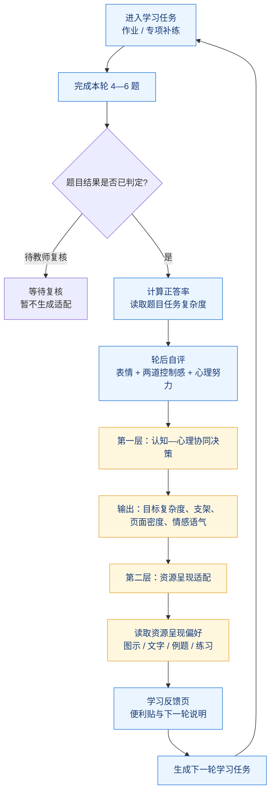
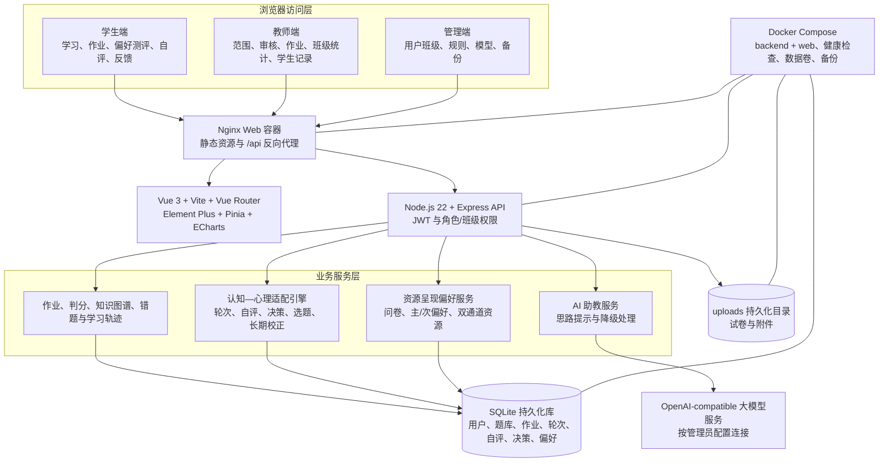
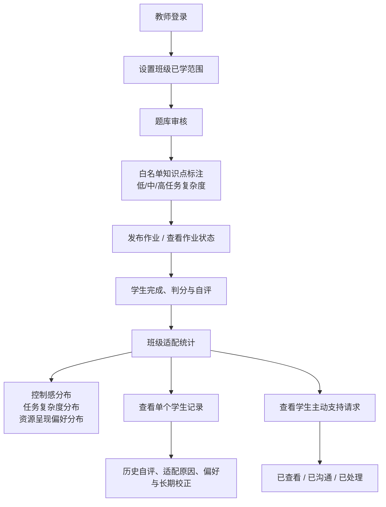
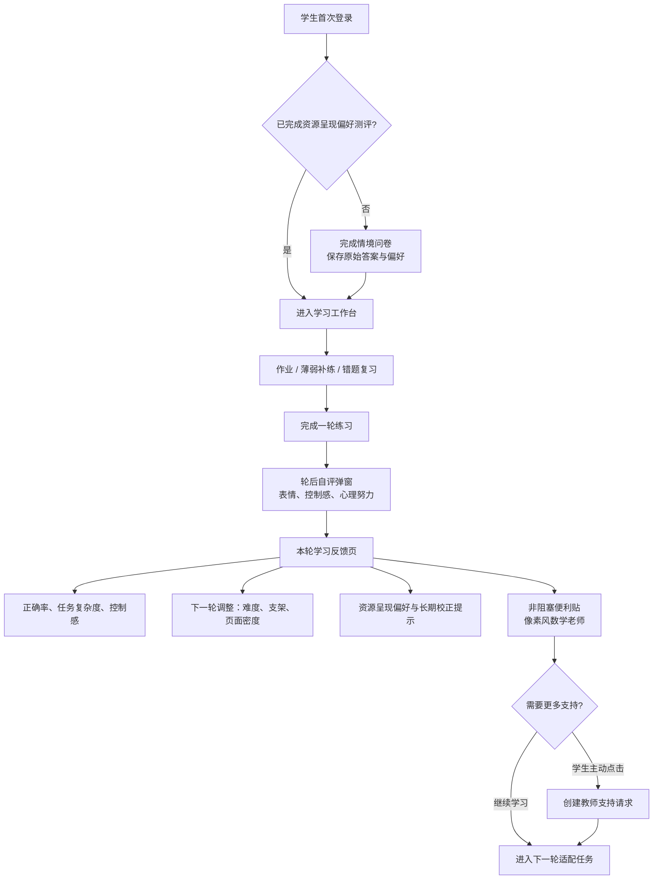
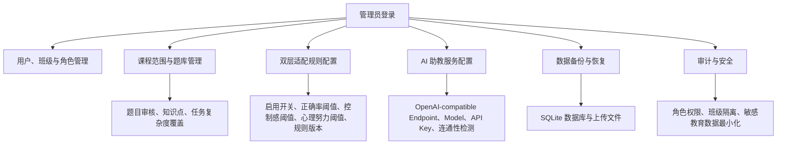

# 智析数学研究报告更新清单与新版图稿

> 适用对象：`智析数学 研究报告.pdf` 的功能与技术章节更新。  
> 使用原则：报告只陈述当前已实现、可验证的能力；“资源呈现偏好”不等同于能力标签或心理诊断。

## 一、必须修改的内容

| 原报告位置 | 原叙事或旧图的问题 | 新版应改为 |
| --- | --- | --- |
| 摘要、研究目标、产品创新 | 以自动批改、知识图谱、AI 助教作为主要创新 | 主创新改为“任务复杂度、正答率、情境性学业控制感、心理努力共同驱动下一轮学习支持”；自动批改、图谱、AI 助教改为原有基础能力。 |
| VARK 相关表述 | 容易写成固定学习类型，甚至暗示能力差异 | 统一写“多模态学习资源呈现偏好”。它只调整图示、文字、例题或练习的呈现顺序，不改变知识目标或第一层确定的难度。 |
| 教育心理学表述 | 容易把问卷结果写成学生心理状态诊断 | 明确为情境性、学习支持性自评；不用于心理健康诊断、能力定型、排名或升学评价。 |
| 生效范围 | 原报告将推荐逻辑笼统描述为适用于数学全模块 | 首期只在整式、整式加减、分式与分式运算、一元一次方程启用；其余知识点保持原有推送和页面逻辑。 |
| 表 1 核心功能与实现要点 | 缺少新增机制 | 加入轮后自评、第一层适配、第二层适配、长期校正四行，见第二节。 |
| 技术栈表 | 固定写死 DeepSeek 或单一模型、旧版依赖版本 | 写为“可配置的 OpenAI-compatible 大模型服务”；补充 Node 22、Docker Compose、Nginx、SQLite 与上传文件持久化卷、备份恢复。 |
| 第 3 章测试 | 旧版只覆盖原有作业、图谱、权限和 33 项回归 | 增加首次偏好拦截、自评必填、适配决策边界、白名单隔离、长期校正、权限、重启持久化与端到端链路。 |
| 第 4 章创新 | “自动升降难度”的表述过于机械 | 新增“认知—心理双维度协同适配创新”。强调任务复杂度、支架、页面密度与情感语气是独立输出。 |
| 第 6 章后续计划 | 缺少教育价值验证 | 增加原推荐组、第一层适配组、双层适配组的对照设计；比较迁移表现、完成率、努力、控制感与教师支持请求。 |

## 二、可直接替换到表 1 的新增功能行

| 新增功能 | 实现要点 | 报告中必须写清的边界 |
| --- | --- | --- |
| 轮后自评 | 表情选择、两道学业控制感题、一道心理努力题；必答校验；保存原始答案、得分、等级和轮次。 | 自评反映当前轮次体验，不构成心理诊断。 |
| 第一层适配 | 综合正答率、题目任务复杂度、控制感和心理努力，输出下一轮目标复杂度、支架等级、页面密度、情感语气和可解释原因。 | 任务难度与支架不能写成同一个变量；每轮最多调整一级。 |
| 第二层适配 | 读取学生资源呈现偏好，优先匹配图示、文字、例题或练习资源。 | 不改变第一层已确定的知识目标和题目难度。 |
| 长期校正 | 累积至少 6 个有效轮次后评估；仅在持续低效且第二偏好接近时扩展为双通道资源呈现。 | 证据不足时只观察，不随意更改偏好。 |
| 情感支持与教师入口 | 反馈后显示可关闭便利贴；学生主动点击后才创建教师支持请求。 | AI 助教不能替代教师，系统不得自动代发心理求助。 |

## 三、图件替换清单

| 原图号 | 是否替换 | 新图名称 | 要体现的内容 |
| --- | --- | --- | --- |
| 图 1—图 3 调研图 | 可保留，补说明 | 探索性调研结果 | 必须补样本量、对象、时间与题项来源；否则不作为强结论。 |
| 图 4 系统整体使用流程 | **必须替换** | 图 4 学生学习与双层适配闭环 | 完成练习 → 自动判分/复核 → 轮后自评 → 第一层决策 → 第二层资源适配 → 反馈页 → 下一轮。 |
| 图 5 系统总体技术架构 | **必须替换** | 图 5 系统技术与数据架构 | 三端、Nginx、前端、Express、SQLite、上传文件、AI 服务、Docker Compose 与数据持久化。 |
| 图 6 教师端流程 | **必须替换** | 图 6 教师端教学与适配管理流程 | 已学范围、题库审核与复杂度、作业发布、班级分布、学生历史记录、支持请求。 |
| 图 7 学生端流程 | **必须替换** | 图 7 学生端学习与反馈流程 | 首次偏好测评、作业/补练、轮后自评、便利贴、反馈页、下一轮适配任务。 |
| 图 8 管理端流程 | **建议整体替换** | 图 8 管理端配置与运维流程 | 账号班级、课程数据、适配阈值/开关、OpenAI-compatible 模型配置、备份恢复、审计。 |
| 图 9 甘特图 | 更新 | 图 9 研发与验证计划 | 补“规则设计、题库复杂度标注、双层适配、UI 迭代、端到端测试、试点评估”。 |
| 图 10—图 14 测试图 | 更新 | 新版功能与验收测试 | 不再把旧版 33 项回归表述为最新版全量验证。 |
| 图 15 Logo | 保留 | 图 15 产品标识 | 当前 Logo 未改动。 |
| 图 16—图 26 界面截图 | 大部分替换 | 当前笔记本风格页面 | 至少替换登录、偏好测评、轮后自评、学习反馈、教师适配统计、像素老师助教。 |

## 四、新图 4：学生学习与双层适配闭环

**图题建议：** 图 4 学生学习与认知—心理双层适配闭环

**正文说明可直接使用：**

> 系统不以单一正确率机械升降难度。第一层首先综合学习表现、任务复杂度、情境性学业控制感与心理努力，确定下一轮任务复杂度、支架等级、页面信息密度与情感语气；第二层随后根据资源呈现偏好组织图示、文字、例题或练习资源。第二层不改变第一层确定的知识目标和任务难度。

## 五、新图 5：系统技术与数据架构

**结论：原“系统总体技术架构图”必须换。** 原图只展示旧的作业/图谱/AI 链路，未表现当前的双层适配服务、三端权限、模型可配置性和生产持久化路径。

**图题建议：** 图 5 智析数学系统技术与数据架构

**技术栈表应使用的准确口径：**

| 层级 | 推荐写法 |
| --- | --- |
| 前端 | Vue 3、Vite、Vue Router、Element Plus、Pinia、ECharts；内部页面采用米白方格笔记本风格。 |
| 后端 | Node.js 22、Express、REST API、JWT、基于角色与班级的数据访问控制。 |
| 数据 | SQLite，持久化保存业务数据、自评原始数据、适配决策、偏好与长期校正记录；上传文件独立持久化。 |
| 模型 | 可配置的 OpenAI-compatible 大模型服务；可接入 Qwen、DeepSeek 等兼容接口，未配置时不阻断核心学习链路。 |
| 部署 | Docker Compose 编排 backend 与 web；Nginx 托管前端并反向代理 API；数据库与上传目录使用宿主机数据卷，支持备份恢复。 |

## 六、新图 6：教师端教学与适配管理流程

**图题建议：** 图 6 教师端教学与认知—心理适配管理流程

**教师端新增或需要更新的功能文字：**

1. 在原有班级、作业、题库、阅卷和学情查看功能上，增加白名单知识点的任务复杂度标注与审核。
2. 在首页或班级统计页展示控制感分布、题目任务复杂度分布、资源呈现偏好分布和学生主动求助数量。
3. 在学生详情页展示历史自评、心理努力、适配决策及其原因、当前资源呈现偏好和长期校正记录。
4. 教师仅能查看本人班级学生的记录；所有信息均标注为“学习状态参考，非心理诊断”。

## 七、新图 7：学生端学习与反馈流程

**图题建议：** 图 7 学生端学习与适配反馈流程

**学生端新增或需要更新的功能文字：**

1. 首次登录先完成资源呈现偏好测评，之后自动加载对应资源组织方式。
2. 在指定知识点完成一轮练习后，必须完成自评；题目待教师复核时暂不生成最终适配决策。
3. 学习反馈页解释本轮正确率、任务复杂度、控制感、下一轮调整和资源偏好，避免黑箱推荐。
4. 低控制感时展示安抚、拆步和留白；高控制感时展示变式、迁移或解释要求，避免单纯表扬。
5. 像素风数学老师是 AI 学习助教的视觉代理；学生主动点击后才向教师创建支持请求。

## 八、新图 8：管理端配置与运维流程

**图题建议：** 图 8 管理端配置、权限与运维流程

**管理员端新增或需要更新的功能文字：**

1. 管理员可启用/关闭双层适配，并配置控制感、正确率、高心理努力等规则阈值和规则版本。
2. 管理员通过页面或环境变量配置 OpenAI-compatible 大模型服务；Qwen、DeepSeek 等只需填入各自的兼容 Endpoint、Model 和 Key。
3. 管理员负责题库与知识点维护、用户班级维护、数据备份恢复；学生端不暴露模型 Key。
4. 生产部署使用容器化服务与持久化数据卷。数据库和上传文件必须一起备份，容器重启不应丢失学习记录。

## 九、现有截图的替换优先级

| 优先级 | 建议截图 | 报告用途 |
| --- | --- | --- |
| P0 | 本轮学习反馈页 | 直接证明第一层决策、第二层资源呈现、便利贴和像素老师。 |
| P0 | 轮后自评弹窗 | 证明控制感与心理努力的原始数据来源及必填交互。 |
| P0 | 教师端班级即时学习状态 / 学生详情 | 证明教师端可以查看分布与记录，而非只有学生端。 |
| P1 | 首次资源呈现偏好测评页 | 证明第二层适配的入口与表述边界。 |
| P1 | 管理端双层适配设置与 AI 助教配置 | 证明阈值、规则版本和模型服务可配置。 |
| P1 | 题目审核或题库复杂度字段 | 证明题目任务复杂度并非运行时随意猜测。 |

## 十、答辩时不可使用的表述

- “VARK 自动决定学生能力或最适合的学习方式。”
- “系统诊断学生的心理状态、焦虑或人格。”
- “AI 助教可以代替教师的情感引导。”
- “系统只要测一次就永久改变学生标签。”
- “所有初中数学知识点都已经启用双层适配。”
- “旧版 33 项回归测试等同于当前版本已完整验收。”

## 十一、答辩时建议使用的总结句

> 智析数学并非只根据对错调整难度。系统首先把题目任务复杂度、学生正答率、当轮控制感与心理努力整合为可解释的学习支持决策，再以资源呈现偏好组织图示、文字、例题或练习。它的目标不是给学生贴标签，而是在教师仍然主导的前提下，降低不必要的认知负担，让下一步学习更合适。
